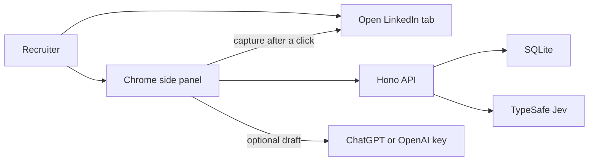

# Who Fits?

[](https://github.com/PouyaJigsaw/decision-assistant/actions/workflows/test.yml)

Screen a LinkedIn profile against a job rubric. Get **Contact**, **Investigate**, **Save for later**, or **Skip**.

Who Fits? is a Chrome side panel for recruiters. Paste a job description, review an editable rubric, open a LinkedIn profile, and evaluate that tab. [TypeSafe Jev](https://typesafe.ai) answers the rubric. Application code picks the action. Nothing is messaged to the candidate.

The extension reads the open LinkedIn profile only after the recruiter chooses to capture it.

Hosted API: [https://decision-assistant.fly.dev](https://decision-assistant.fly.dev) · Privacy: [https://decision-assistant.fly.dev/privacy](https://decision-assistant.fly.dev/privacy)


## Architecture



| Path | What it is |
| --- | --- |
| [`apps/extension`](apps/extension) | Chrome MV3 side panel (WXT + React) |
| [`apps/api`](apps/api) | Hono server, SQLite via Drizzle, Fly.io |
| [`packages/domain`](packages/domain) | Rubric, Jev mapping, safety scan, recommendation, cost, trial cap |

ChatGPT or an OpenAI API key is optional and stays in the browser. Without a connected model, the hosted API can draft a limited number of roles.

The LinkedIn host permission plus `scripting` exists so the panel can read the focused profile after the recruiter chooses to capture it. The extension does not run content scripts on every page load and does not message candidates.

## Install the Chrome extension

The Chrome Web Store listing is not published yet. Grab the packaged build from [Releases](https://github.com/PouyaJigsaw/decision-assistant/releases/latest):

1. Download `who-fits-*-chrome.zip` and unzip it into its own folder.
2. Open `chrome://extensions`, turn on **Developer mode**, and click **Load unpacked**.
3. Select that unzipped folder (it must contain `manifest.json`).

Chrome does not install a `.zip` directly. The release build talks to the hosted API at `https://decision-assistant.fly.dev`. Use **Run locally** below only when you want to point the panel at your own API.

Pushing a `v*` tag builds this zip in CI and attaches it to a GitHub release.

## Run locally

Requires Node 20+ and [pnpm](https://pnpm.io) 9.15.

```bash
pnpm install
cp apps/api/.env.example apps/api/.env
```

Fill `TYPESAFE_API_KEY` for live Jev, or set `PROVIDERS=fake` in `apps/api/.env` to run without provider keys. `LLM_API_KEY` is optional; rubric drafts can use ChatGPT or an OpenAI key in the extension instead.

```bash
pnpm --filter @decision-assistant/api start
pnpm --filter @decision-assistant/extension build:local
```

Open `chrome://extensions`, enable Developer mode, and load unpacked from `apps/extension/unpacked/chrome-mv3`. Reload the extension there after each rebuild.

`pnpm --filter @decision-assistant/extension build` points the panel at the hosted API (`https://decision-assistant.fly.dev`). Use `build:local` when the API is on `http://127.0.0.1:8787`.

## Tests

```bash
pnpm test
```

Playwright journeys in [`e2e/`](e2e) need a signed-in LinkedIn tab and are not part of `pnpm test`. See [`e2e/README.md`](e2e/README.md).

## Hosted deploy

[`apps/api/fly.toml`](apps/api/fly.toml) is the Fly.io app `decision-assistant` in `sjc`, with SQLite on a volume.

```bash
fly deploy -c apps/api/fly.toml
```

Secrets (`ACCOUNT_EMAIL`, `ACCOUNT_PASSWORD`, `TYPESAFE_API_KEY`, and the rest) stay in `fly secrets`, not in git.

## License

MIT. See [LICENSE](LICENSE).
