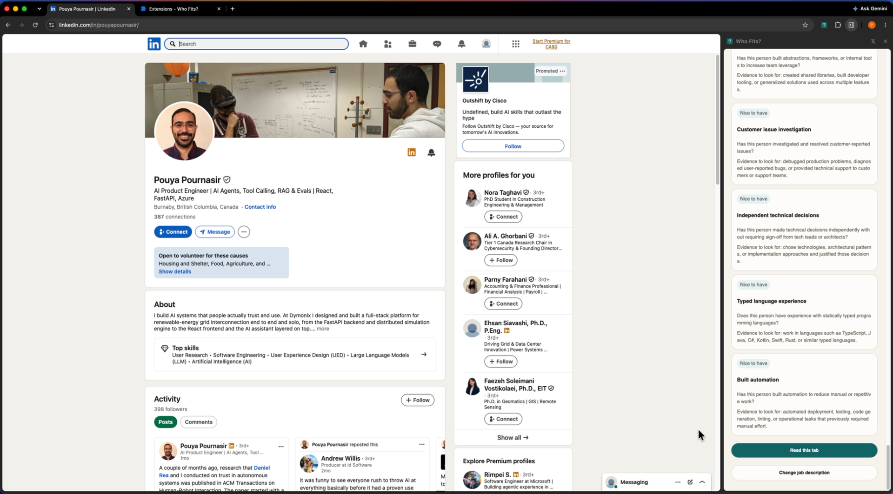
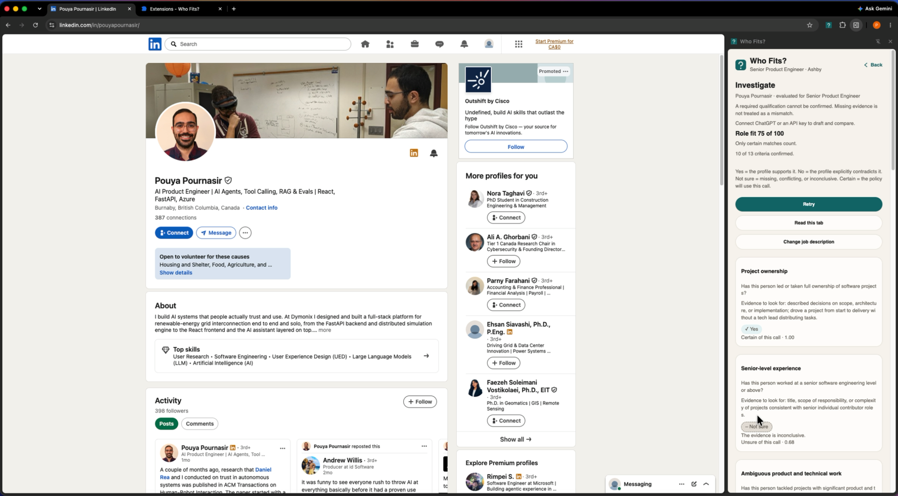
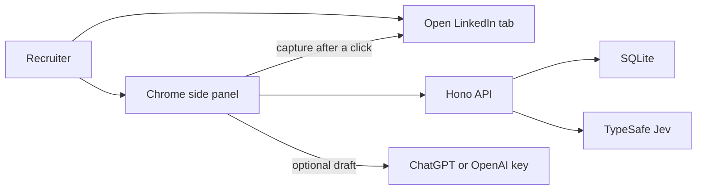

# Who Fits?

[](https://github.com/PouyaJigsaw/decision-assistant/actions/workflows/test.yml)

Screen a LinkedIn profile against a job rubric. Get **Contact**, **Investigate**, **Save for later**, or **Skip**.

Who Fits? is a Chrome side panel for recruiters. Paste a job description, review an editable rubric, open a LinkedIn profile, and evaluate that tab. [TypeSafe Jev](https://typesafe.ai) answers the rubric. Application code picks the action. Nothing is messaged to the candidate.

The extension reads the open LinkedIn profile only after the recruiter chooses to capture it.

Hosted API: [https://decision-assistant.fly.dev](https://decision-assistant.fly.dev) · Privacy: [https://decision-assistant.fly.dev/privacy](https://decision-assistant.fly.dev/privacy)





## Architecture



| Path | What it is |
| --- | --- |
| [`apps/extension`](apps/extension) | Chrome MV3 side panel (WXT + React) |
| [`apps/api`](apps/api) | Hono server, SQLite via Drizzle, Fly.io |
| [`packages/domain`](packages/domain) | Rubric, Jev mapping, safety scan, recommendation, cost, trial cap |

ChatGPT or an OpenAI API key is optional and stays in the browser. Without a connected model, the hosted API can draft a limited number of roles.

The LinkedIn host permission plus `scripting` exists so the panel can read the focused profile after the recruiter chooses to capture it. The extension does not run content scripts on every page load and does not message candidates.

## Install the Chrome extension

There is no Chrome Web Store listing yet. Install the packaged build from GitHub.

### 1. Download the zip

Open the [latest release](https://github.com/PouyaJigsaw/decision-assistant/releases/latest). Under **Assets**, download `who-fits-*-chrome.zip` (for example [`who-fits-0.0.1-chrome.zip`](https://github.com/PouyaJigsaw/decision-assistant/releases/download/v0.0.1/who-fits-0.0.1-chrome.zip)).

Do not use **Source code (zip)**. That is the repository, not the extension.

### 2. Unzip it into its own folder

The archive has `manifest.json` at the top level. Unzip into an empty folder and leave that folder on disk. Chrome loads the extension from that path; moving or deleting it breaks the install.

- macOS: double-click the zip, or run `unzip who-fits-*-chrome.zip -d who-fits`
- Windows: right-click → **Extract All** and choose a new folder

You should see `manifest.json`, `background.js`, and `sidepanel.html` in that folder.

### 3. Load it in Chrome

1. Go to `chrome://extensions`.
2. Turn on **Developer mode** (top right).
3. Click **Load unpacked**.
4. Select the unzipped folder (the one that contains `manifest.json`).

Chrome may show “Disable developer mode extensions” on later launches. That warning is expected for an unpacked install. Keep Developer mode on.

Pin Who Fits? from the puzzle-piece menu if you want the toolbar icon visible.

### 4. Use it

This build talks to the hosted API at [https://decision-assistant.fly.dev](https://decision-assistant.fly.dev). You do not need to run the API yourself.

1. Open a LinkedIn profile (`linkedin.com/in/...`).
2. Click the Who Fits? toolbar icon. The side panel opens and reads that tab only because you clicked.
3. Choose **Sign up**, enter an email and a password of at least 8 characters, then **Create account**. Use **Sign in** if you already have an account.
4. Paste a full job description (at least 150 words), draft the rubric, edit it, and approve it.
5. With the LinkedIn profile still focused, use **Read this tab** / evaluate. Jev answers the rubric. The panel recommends **Contact**, **Investigate**, **Save for later**, or **Skip**.

Nothing is messaged to the candidate. ChatGPT or an OpenAI API key is optional and stays in the browser.

To rebuild from source and point at your own API instead, use **Run locally** below.

Pushing a `v*` tag builds a new zip in CI and attaches it to a GitHub release.

## Run locally

Requires Node 20+ and [pnpm](https://pnpm.io) 9.15.

```bash
pnpm install
cp apps/api/.env.example apps/api/.env
```

Fill `TYPESAFE_API_KEY` for live Jev, or set `PROVIDERS=fake` in `apps/api/.env` to run without provider keys. `LLM_API_KEY` is optional; rubric drafts can use ChatGPT or an OpenAI key in the extension instead.

```bash
pnpm --filter @decision-assistant/api start
pnpm --filter @decision-assistant/extension build:local
```

Open `chrome://extensions`, enable Developer mode, and load unpacked from `apps/extension/unpacked/chrome-mv3`. Reload the extension there after each rebuild.

`pnpm --filter @decision-assistant/extension build` points the panel at the hosted API (`https://decision-assistant.fly.dev`). Use `build:local` when the API is on `http://127.0.0.1:8787`.

## Tests

```bash
pnpm test
```

Playwright journeys in [`e2e/`](e2e) need a signed-in LinkedIn tab and are not part of `pnpm test`. See [`e2e/README.md`](e2e/README.md).

## Hosted deploy

[`apps/api/fly.toml`](apps/api/fly.toml) is the Fly.io app `decision-assistant` in `sjc`, with SQLite on a volume.

```bash
fly deploy -c apps/api/fly.toml
```

Secrets (`ACCOUNT_EMAIL`, `ACCOUNT_PASSWORD`, `TYPESAFE_API_KEY`, and the rest) stay in `fly secrets`, not in git.

## License

MIT. See [LICENSE](LICENSE).
